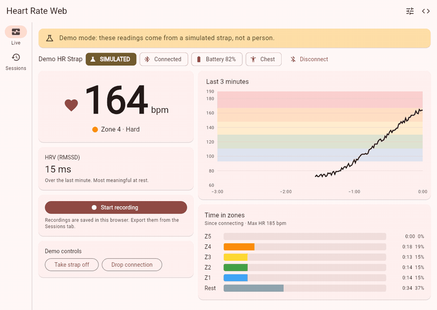

# Heart Rate Web

[](https://github.com/ChandraChaan/heart-rate-web/actions/workflows/ci.yml)
[](https://github.com/ChandraChaan/heart-rate-web/actions/workflows/pages.yml)
[](LICENSE)
[](https://flutter.dev)
[](https://pub.dev/packages/ble_gatt_parser)

Use any Bluetooth heart-rate strap in the browser. Open the page, pick your strap, and see your heart rate, training zones and HRV live. Record a session and export it. Nothing to install, no account, and your data never leaves the browser.

<p align="center">
  <a href="https://chandrachaan.github.io/heart-rate-web/"></a>
  <br>
  <b><a href="https://chandrachaan.github.io/heart-rate-web/">Open the live app</a></b>: no strap? Press <i>Try demo mode</i>.
</p>

## Features

- **Connect** to any sensor with the standard Bluetooth Heart Rate service (`0x180D`): chest straps and armbands from Polar, Garmin, Wahoo, Coospo and others, and many watches when they broadcast heart rate.
- **Live view:** big bpm readout, a scrolling three-minute chart drawn over coloured zone bands, the current zone, battery level, where the sensor is worn, and a warning when the strap loses skin contact.
- **Heart-rate zones** from your age (220 − age) or a measured max HR, with time spent in each zone.
- **HRV (RMSSD)** over the last minute, when the strap sends RR-intervals. Artefacts and missed beats are filtered out.
- **Recording:** start and stop a session, see average, min and max heart rate, duration, time in zones, HRV and energy, and export it as **CSV**.
- **Reconnects** by itself when the strap drops out of range, and offers a manual retry if it stays away. A recording keeps going through the gap.
- **Demo mode** runs a simulated chest strap through exactly the same code, clearly labelled *Simulated*, so anyone can try the app.

## Supported browsers

The app uses [Web Bluetooth](https://developer.mozilla.org/docs/Web/API/Web_Bluetooth_API), which only some browsers have:

| Browser | Works? |
| --- | --- |
| Chrome, Edge, Opera on Windows, macOS, ChromeOS | Yes |
| Chrome on Android | Yes |
| Chrome on Linux | Behind a flag (`chrome://flags/#enable-experimental-web-platform-features`) |
| Safari on macOS | No |
| Any browser on iPhone or iPad | No (they all use Safari's engine) |
| Firefox | No |

Where Web Bluetooth is missing the app says so, and demo mode still works. Web Bluetooth also needs HTTPS, which GitHub Pages provides.

**Tip:** straps only advertise while worn. Wet the electrodes and put the strap on before you press *Connect a strap*, and disconnect it from other apps first.

## Privacy

Readings never leave your browser. There is no server, no account, no analytics and no tracking. Recordings are kept in the browser's local storage on your device, and exports are created in the browser and downloaded straight to your computer. Clearing the site's data deletes them.

## Not a medical device

This is a hobby and training tool, not a medical device. Don't use it to diagnose, treat or monitor any medical condition. Consumer straps can be wrong, the 220 − age estimate of max HR can be off by 10 bpm or more, and HRV measured during exercise isn't comparable with resting HRV. If something about your heart rate worries you, talk to a doctor.

## How it works

```
Web Bluetooth strap ─┐
                     ├─> HeartRateLink ─> ble_gatt_parser ─> controllers ─┬─> live view
Simulated strap ─────┘   (raw bytes)      (typed values)     (Riverpod)   └─> recorder ─> local storage ─> CSV
```

- [`flutter_web_bluetooth`](https://pub.dev/packages/flutter_web_bluetooth) talks to the strap. It sits behind two small interfaces, `HeartRateConnector` and `HeartRateLink`, in [`lib/features/monitor/domain/heart_rate_link.dart`](lib/features/monitor/domain/heart_rate_link.dart).
- Every notification is parsed by [`ble_gatt_parser`](https://pub.dev/packages/ble_gatt_parser): bpm (8 or 16 bit), sensor contact, energy expended and RR-intervals from Heart Rate Measurement (`0x2A37`), plus Battery Level (`0x2A19`) and Body Sensor Location (`0x2A38`).
- Demo mode and the tests use [`ble_device_simulator`](https://pub.dev/packages/ble_device_simulator), which sends the same spec-correct bytes a real strap does. So the parser, controllers, recorder and exports are all exercised without hardware.
- Zones, RMSSD and session stats are plain Dart in `domain/` with unit tests.

Folder layout and coding rules for contributors (and coding agents) are in [AGENTS.md](AGENTS.md).

## Run it locally

You need [Flutter](https://docs.flutter.dev/get-started/install) (stable) and Chrome or Edge.

```bash
git clone https://github.com/ChandraChaan/heart-rate-web.git
cd heart-rate-web
flutter run -d chrome
```

`localhost` counts as a secure origin, so Web Bluetooth works there without HTTPS.

Checks that CI runs on every push and pull request:

```bash
dart format --output=none --set-exit-if-changed lib test
flutter analyze
flutter test
flutter build web --release --base-href /heart-rate-web/
```

## Which straps work?

Any sensor that implements the standard Heart Rate service should work, but so far the app has been tested with the simulator only. If you try it with your strap or watch, please say how it went in [Discussions](https://github.com/ChandraChaan/heart-rate-web/discussions), especially if something doesn't work.

## Contributing

Issues and pull requests are welcome. Please run the checks above before opening a pull request, and keep the rule that health data never leaves the browser.

## License

[MIT](LICENSE)
